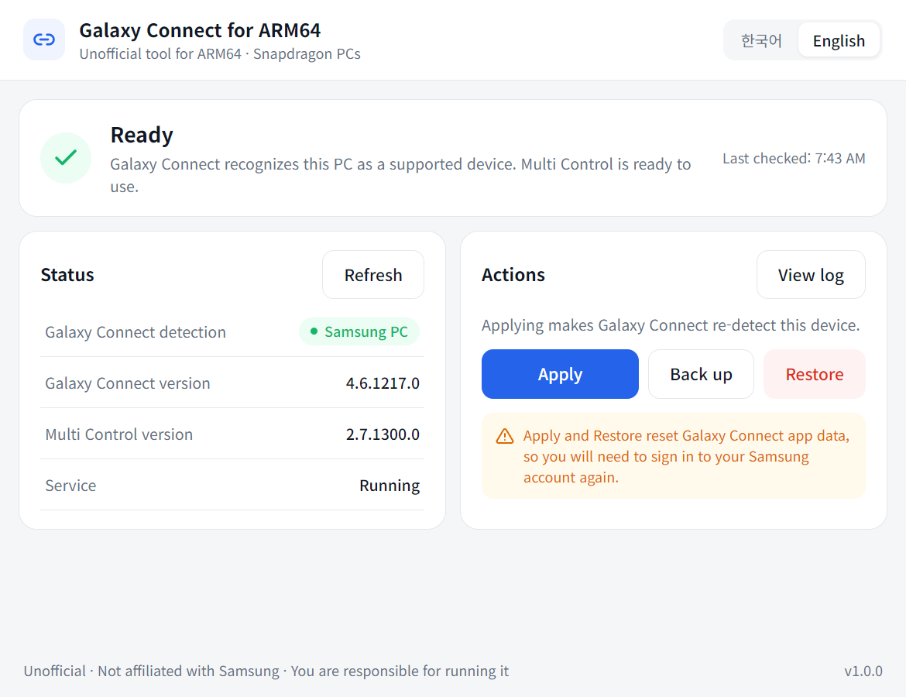
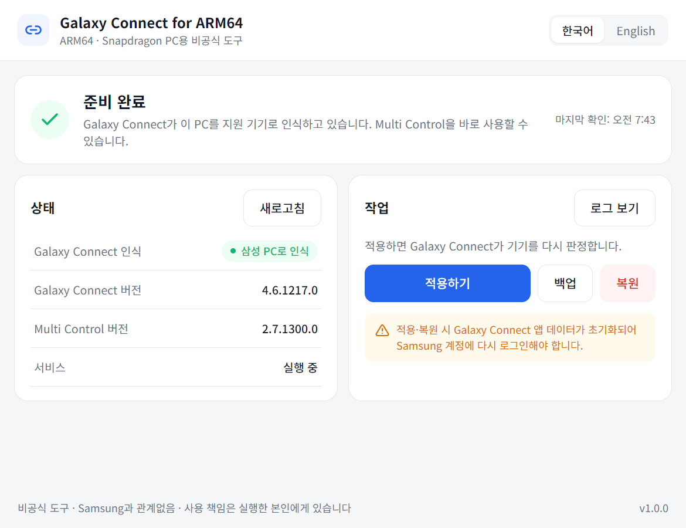

# Galaxy-Connect-for-arm64

**[English](#english) · [한국어](#한국어)**

---

## English

An unofficial tool that lets **Galaxy Connect** and **Multi Control** run on non-Samsung
**Windows ARM64 (Snapdragon)** laptops. It comes as a desktop app with a Korean/English UI,
and as PowerShell scripts that do the same thing.

> [!WARNING]
> **Read this before running anything**
>
> - **You run this software entirely at your own risk. The person who runs it is solely
>   responsible for any consequences**, including problems with the system, apps, data,
>   accounts, warranty or services.
> - The authors and contributors accept no liability for any damage. The software is provided
>   "AS IS", without warranty of any kind (see [LICENSE](LICENSE)).
> - This is an unofficial project and is not affiliated with Samsung Electronics.
>   Samsung, Galaxy, Galaxy Connect and Multi Control are trademarks of Samsung Electronics.
> - It was made for personal research and experimentation. It may not comply with Samsung's
>   terms of service, and your account or use of the service could be affected.
> - If you do not agree, do not use it. If something goes wrong, see [Restoring](#restoring).



### Contents

- [Verified environment](#verified-environment)
- [Requirements](#requirements)
- [Option 1: Desktop app (recommended)](#option-1-desktop-app-recommended)
- [Option 2: PowerShell scripts](#option-2-powershell-scripts)
- [When to apply again](#when-to-apply-again)
- [Restoring](#restoring)
- [Troubleshooting](#troubleshooting)
- [Effects on other programs](#effects-on-other-programs)
- [Known limitations](#known-limitations)
- [Building the app from source](#building-the-app-from-source)
- [Project structure](#project-structure)
- [License](#license)

### Verified environment

| Item | Value |
|---|---|
| PC | HP OmniBook X Laptop 14-fe0xxx |
| CPU | Snapdragon X Elite X1E78100 |
| Wi-Fi / Bluetooth | Qualcomm FastConnect 7800 |
| OS | Windows 11 ARM64 (10.0.26200) |
| Galaxy Connect | 4.6.1217.0 |
| Multi Control | 2.7.1300.0 |
| Phone | Galaxy Z Fold8 |
| Confirmed working | Multi Control mouse and keyboard sharing |

Other devices or other app versions may not work.

### Requirements

- Windows 11 on ARM64 (Snapdragon)
- **Galaxy Connect** and **Multi Control** installed from the Microsoft Store
- An administrator account (a UAC prompt appears when changes are made)
- A Samsung account, signed in on both the PC and the phone
- PC and phone on the **same Wi-Fi network**, with Bluetooth turned on on both
- For the scripts only: Windows PowerShell 5.1 (built into Windows) or PowerShell 7

### Option 1: Desktop app (recommended)

#### 1. Install the Samsung apps

Install **Galaxy Connect** and **Multi Control** from the Microsoft Store.
Do this before running the tool.

#### 2. Download and run the app

1. Download `GalaxyConnectForARM64-<version>-arm64-portable.exe` from the Releases page.
2. Double-click it. No installation is needed.
3. The app is not code-signed, so Windows SmartScreen may show
   **"Windows protected your PC"**. Click **More info → Run anyway**.
   If you would rather not, [build it yourself](#building-the-app-from-source).

#### 3. Accept the consent dialog

On first launch, a dialog explains the risks. Read it, tick
**"I understand and agree to the above"**, then click **Agree and start**.
Clicking **Quit** closes the app without changing anything.

#### 4. Choose a language

Use the **한국어 / English** switch in the top-right corner. The choice is remembered.

#### 5. Check the current status

The **Status** card is read without administrator rights. Click **Refresh** to read it again.

| Row | Meaning |
|---|---|
| Galaxy Connect detection | What Galaxy Connect last detected: **Samsung PC** (supported), **Not detected**, or **None** (it has not run yet) |
| Galaxy Connect version | Installed version |
| Multi Control version | Installed version |
| Service | State of the Galaxy Connect background service |

The card across the top summarizes the result:

| Card | Meaning | What to do |
|---|---|---|
| **Ready** | Galaxy Connect treats this PC as supported | Nothing. Use Multi Control |
| **Applied · launch the app** | Applied, but Galaxy Connect has not run yet | Launch Galaxy Connect and sign in |
| **Not applied yet** | Galaxy Connect treats this PC as unsupported | Click **Apply** |
| **Galaxy Connect not installed** | The Store app is missing | Install it, then click **Apply** |

#### 6. Apply

1. Click **Apply**, read the confirmation, and click **Continue**.
2. Click **Yes** in the UAC prompt.
3. When it finishes, **Done.** appears in the **Actions** card. Click **View log** to see each step.
   - The original values are backed up automatically the first time.
   - **Galaxy Connect app data is reset**, so you will be signed out of it.

#### 7. Finish setup

1. Launch **Galaxy Connect** and sign in to your Samsung account.
2. Go back to the tool and click **Refresh**. The card should say **Ready**.
3. On the phone, sign in to the **same Samsung account**, join the **same Wi-Fi**,
   and turn on Bluetooth and **Multi control** (Settings → Connected devices).
4. Open **Multi Control** on the PC and connect to your phone.

Once it shows **Ready**, it keeps working after a reboot.

#### Other buttons

- **Back up**: saves the original registry values. Not needed if you use Apply, which backs up automatically.
  Backups made by the app are stored in `%APPDATA%\Galaxy Connect for ARM64\backup`.
- **Restore**: puts the original values back and resets Galaxy Connect app data. See [Restoring](#restoring).

### Option 2: PowerShell scripts

The desktop app runs these same scripts, so the result is identical.

#### 1. Get the files

Download or clone this repository, then open PowerShell in that folder:

```powershell
cd C:\path\to\Galaxy-Connect-for-arm64
```

#### 2. Allow scripts for this window only

```powershell
Set-ExecutionPolicy -Scope Process Bypass
```

This only affects the current PowerShell window and is reset when you close it.

#### 3. Check the status (no administrator rights needed)

```powershell
.\Status.ps1
```

It prints the registry values, the value seen by apps, the firmware values, the installed app
versions, the service state and recent detection log lines.

#### 4. Apply

```powershell
.\Apply.ps1
```

If PowerShell is not running as administrator, a UAC prompt appears and the script reopens in a
new administrator window. It then:

1. Backs up the original values to `backup\` (skipped if a backup already exists).
2. Changes the manufacturer and model values in the registry.
3. Checks that Windows now reports the new manufacturer.
4. Resets Galaxy Connect app data and restarts its service.

Then follow [Finish setup](#7-finish-setup) and run `.\Status.ps1` to confirm that the log shows
`IsSamsungDevice: True`.

Optional parameters (defaults shown):

```powershell
.\Apply.ps1 -Manufacturer 'Samsung Electronics' -ProductName '940XMA' -Family 'Galaxy Book4 Edge'
```

#### 5. Back up only

```powershell
.\Backup.ps1          # skipped if a backup already exists
.\Backup.ps1 -Force   # overwrite the existing backup
```

If the registry already contains Samsung values, the backup stops so that it does not save the
wrong values. Reboot, then run it again.

#### 6. Restore

```powershell
.\Restore.ps1
```

### When to apply again

Galaxy Connect keeps working across reboots. Run **Apply** again only if:

- you reset Galaxy Connect app data,
- you uninstalled and reinstalled Galaxy Connect,
- you reinstalled Windows (install the Store apps first, then apply), or
- it stops working after a Galaxy Connect update.

### Restoring

- **App**: click **Restore**, then **Continue**, then **Yes** in the UAC prompt.
- **Script**: run `.\Restore.ps1`.

Restore puts back the backed-up registry values (or, without a backup, the real firmware values)
and resets Galaxy Connect app data. Galaxy Connect and Multi Control will then stop working on
this PC. A reboot alone also returns the registry to its original values.

To remove the tool completely after restoring:

1. Delete the `.exe` (or the repository folder).
2. Delete `%APPDATA%\Galaxy Connect for ARM64` (app settings and backups).

### Troubleshooting

| Symptom | Fix |
|---|---|
| SmartScreen blocks the app | **More info → Run anyway**, or build it yourself |
| "The administrator prompt was cancelled." | Click the button again and choose **Yes** in the UAC prompt |
| Card stays **Not applied yet** after Apply | Click **Refresh**. If it persists, click **View log**, look for `ERROR` lines and apply again |
| Card shows **Applied · launch the app** | Launch Galaxy Connect, sign in, then click **Refresh** |
| Multi Control finds no devices | Same Samsung account on both, same Wi-Fi, Bluetooth on, Multi control enabled on the phone. Then restart Multi Control |
| Script: "running scripts is disabled on this system" | Run `Set-ExecutionPolicy -Scope Process Bypass` first |
| Script: Apply warns that apps do not see Samsung yet | Nothing was reset. Run `.\Restore.ps1` or reboot, then try again |
| It stopped working after an update | Apply again. If that does not help, the new version may not be supported |

### Effects on other programs

- **CPU and architecture information is not changed.** ARM64/Snapdragon detection, x64 emulation
  and drivers are unaffected.
- Firmware values read through WMI are not changed.
- Between applying and the next reboot, programs that read the manufacturer from the registry may
  see Samsung. After a reboot, the registry returns to its original values.

### Known limitations

- A Galaxy Connect update may stop this from working.
- Only Multi Control mouse and keyboard sharing has been confirmed. Some features may be disabled
  on Qualcomm PCs.
- This PC's real serial number is still sent to Samsung services. How the server treats it is unknown.
- The app is not code-signed.

### Building the app from source

Requires Node.js 22 or later.

```powershell
cd app
npm install
npm start        # build the UI and run the app without packaging
npm run dist     # create app\release\GalaxyConnectForARM64-<version>-arm64-portable.exe
```

The UI is Electron + React. It only displays information and runs the PowerShell scripts in the
repository root; all changes are made by those scripts.

### Project structure

| Path | Description |
|---|---|
| `Apply.ps1` | Apply (back up → change registry → reset app data → restart service) |
| `Backup.ps1` | Back up the original registry values |
| `Restore.ps1` | Restore the original values |
| `Status.ps1` | Show status and detection log (`-Json` for the app) |
| `lib\Common.ps1` | Shared functions |
| `app\` | Desktop app (Electron + React) |
| `docs\` | Screenshots for this README |
| `backup\` | Backups made by the scripts. Contains device information; excluded from Git |

### License

[MIT](LICENSE)

---

## 한국어

삼성 PC가 아닌 **Windows ARM64(Snapdragon) 노트북**에서 **Galaxy Connect**와 **Multi Control**을
쓸 수 있게 해 주는 비공식 도구입니다. 한국어·영어 화면을 지원하는 데스크톱 앱과,
같은 일을 하는 PowerShell 스크립트로 제공됩니다.

> [!WARNING]
> **실행하기 전에 반드시 읽어 주세요**
>
> - **이 소프트웨어를 실행해서 생기는 모든 결과의 책임은 직접 실행한 본인에게 있습니다.**
>   시스템, 앱, 데이터, 계정, 보증, 서비스 이용에 생기는 문제가 모두 포함됩니다.
> - 작성자와 기여자는 어떤 손해에도 책임지지 않습니다. 이 소프트웨어는 아무것도 보증하지 않는
>   "있는 그대로(AS IS)" 제공됩니다([LICENSE](LICENSE) 참고).
> - Samsung Electronics와 아무 관계가 없는 비공식 프로젝트입니다.
>   Samsung, Galaxy, Galaxy Connect, Multi Control은 Samsung Electronics의 상표입니다.
> - 개인 연구와 실험 목적으로 만들었습니다. Samsung 서비스 약관에 맞지 않을 수 있으며,
>   계정이나 서비스 이용에 불이익이 생길 수 있습니다.
> - 동의하지 않으면 사용하지 마세요. 문제가 생기면 [복원](#복원)을 참고하세요.



### 목차

- [확인된 환경](#확인된-환경)
- [준비물](#준비물)
- [방법 1: 데스크톱 앱 (권장)](#방법-1-데스크톱-앱-권장)
- [방법 2: PowerShell 스크립트](#방법-2-powershell-스크립트)
- [다시 적용해야 하는 경우](#다시-적용해야-하는-경우)
- [복원](#복원)
- [문제 해결](#문제-해결)
- [다른 프로그램에 주는 영향](#다른-프로그램에-주는-영향)
- [알려진 제한](#알려진-제한)
- [앱 직접 빌드하기](#앱-직접-빌드하기)
- [파일 구성](#파일-구성)
- [라이선스](#라이선스)

### 확인된 환경

| 항목 | 값 |
|---|---|
| PC | HP OmniBook X Laptop 14-fe0xxx |
| CPU | Snapdragon X Elite X1E78100 |
| Wi-Fi / 블루투스 | Qualcomm FastConnect 7800 |
| OS | Windows 11 ARM64 (10.0.26200) |
| Galaxy Connect | 4.6.1217.0 |
| Multi Control | 2.7.1300.0 |
| 폰 | Galaxy Z Fold8 |
| 동작 확인 | Multi Control 마우스·키보드 공유 |

다른 기기나 다른 앱 버전에서는 동작하지 않을 수 있습니다.

### 준비물

- Windows 11 ARM64(Snapdragon) PC
- Microsoft Store에서 설치한 **Galaxy Connect**와 **Multi Control**
- 관리자 계정 (변경할 때 UAC 창이 뜹니다)
- PC와 폰에 모두 로그인할 Samsung 계정
- PC와 폰이 **같은 Wi-Fi**에 연결되어 있고, 둘 다 블루투스가 켜져 있을 것
- 스크립트를 쓸 때만: Windows PowerShell 5.1(Windows 기본 내장) 또는 PowerShell 7

### 방법 1: 데스크톱 앱 (권장)

#### 1. 삼성 앱 설치

Microsoft Store에서 **Galaxy Connect**와 **Multi Control**을 설치합니다.
이 도구를 실행하기 전에 먼저 설치해 주세요.

#### 2. 앱 내려받기와 실행

1. Releases 페이지에서 `GalaxyConnectForARM64-<버전>-arm64-portable.exe`를 내려받습니다.
2. 더블클릭해서 실행합니다. 설치는 필요 없습니다.
3. 코드 서명이 없어서 **"Windows의 PC 보호"** (SmartScreen) 창이 뜰 수 있습니다.
   **추가 정보 → 실행**을 누르세요. 꺼림칙하면 [직접 빌드](#앱-직접-빌드하기)해서 쓰세요.

#### 3. 사용 동의

처음 실행하면 위험성을 설명하는 창이 뜹니다. 내용을 읽고
**"위 내용을 이해했으며 동의합니다"**에 체크한 뒤 **동의하고 시작**을 누릅니다.
**종료**를 누르면 아무것도 바꾸지 않고 앱이 닫힙니다.

#### 4. 언어 선택

오른쪽 위의 **한국어 / English**로 바꿀 수 있습니다. 선택한 언어는 기억됩니다.

#### 5. 현재 상태 확인

**상태** 카드는 관리자 권한 없이 읽습니다. **새로고침**을 누르면 다시 읽습니다.

| 항목 | 의미 |
|---|---|
| Galaxy Connect 인식 | Galaxy Connect가 마지막으로 판정한 결과. **삼성 PC로 인식**(지원), **인식 안 됨**, **없음**(아직 실행 기록 없음) |
| Galaxy Connect 버전 | 설치된 버전 |
| Multi Control 버전 | 설치된 버전 |
| 서비스 | Galaxy Connect 백그라운드 서비스 상태 |

맨 위의 카드는 결과를 요약해서 보여 줍니다.

| 카드 | 의미 | 할 일 |
|---|---|---|
| **준비 완료** | Galaxy Connect가 이 PC를 지원 기기로 인식함 | 없음. Multi Control을 사용하면 됩니다 |
| **적용됨 · 앱 실행 필요** | 적용은 됐지만 Galaxy Connect를 아직 실행하지 않음 | Galaxy Connect를 실행하고 로그인 |
| **아직 적용되지 않음** | Galaxy Connect가 이 PC를 지원하지 않는 기기로 봄 | **적용하기** 클릭 |
| **Galaxy Connect 미설치** | Store 앱이 없음 | 설치한 뒤 **적용하기** 클릭 |

#### 6. 적용하기

1. **적용하기**를 누르고, 확인 창을 읽은 뒤 **계속**을 누릅니다.
2. UAC 창에서 **예**를 누릅니다.
3. 끝나면 **작업** 카드에 **완료했습니다.**가 나옵니다. 단계별 내용은 **로그 보기**에서 볼 수 있습니다.
   - 처음 적용할 때 원래 값이 자동으로 백업됩니다.
   - **Galaxy Connect 앱 데이터가 초기화**되어 로그아웃됩니다.

#### 7. 마무리

1. **Galaxy Connect**를 실행하고 Samsung 계정으로 로그인합니다.
2. 이 도구로 돌아와 **새로고침**을 누릅니다. 카드가 **준비 완료**가 되어야 합니다.
3. 폰에서 **같은 Samsung 계정**으로 로그인하고, **같은 Wi-Fi**에 연결한 뒤,
   블루투스와 **Multi control**(설정 → 연결된 기기)을 켭니다.
4. PC에서 **Multi Control**을 열고 폰과 연결합니다.

**준비 완료**가 된 뒤에는 재부팅해도 계속 동작합니다.

#### 다른 버튼

- **백업**: 원래 레지스트리 값을 저장합니다. 적용하기가 자동으로 백업하므로 따로 누를 필요는 없습니다.
  앱에서 만든 백업은 `%APPDATA%\Galaxy Connect for ARM64\backup`에 저장됩니다.
- **복원**: 원래 값으로 되돌리고 Galaxy Connect 앱 데이터를 초기화합니다. [복원](#복원)을 참고하세요.

### 방법 2: PowerShell 스크립트

데스크톱 앱도 이 스크립트를 그대로 실행하므로 결과는 같습니다.

#### 1. 파일 받기

이 저장소를 내려받거나 clone한 뒤, 그 폴더에서 PowerShell을 엽니다.

```powershell
cd C:\경로\Galaxy-Connect-for-arm64
```

#### 2. 현재 창에서만 스크립트 실행 허용

```powershell
Set-ExecutionPolicy -Scope Process Bypass
```

지금 열린 PowerShell 창에만 적용되고, 창을 닫으면 원래대로 돌아갑니다.

#### 3. 상태 확인 (관리자 권한 필요 없음)

```powershell
.\Status.ps1
```

레지스트리 값, 앱이 보는 값, 펌웨어 값, 설치된 앱 버전, 서비스 상태, 최근 판정 로그를 보여 줍니다.

#### 4. 적용

```powershell
.\Apply.ps1
```

관리자 권한이 아니면 UAC 창이 뜨고, 새 관리자 창에서 스크립트가 다시 실행됩니다. 이어서 다음을 합니다.

1. 원래 값을 `backup\`에 백업합니다. 백업이 이미 있으면 건너뜁니다.
2. 레지스트리의 제조사와 모델 값을 바꿉니다.
3. Windows가 새 제조사를 알려 주는지 확인합니다.
4. Galaxy Connect 앱 데이터를 초기화하고 서비스를 재시작합니다.

그다음 [마무리](#7-마무리) 단계를 진행하고, `.\Status.ps1`을 실행해 로그에
`IsSamsungDevice: True`가 나오는지 확인합니다.

필요하면 값을 바꿀 수 있습니다(아래는 기본값입니다).

```powershell
.\Apply.ps1 -Manufacturer 'Samsung Electronics' -ProductName '940XMA' -Family 'Galaxy Book4 Edge'
```

#### 5. 백업만 하기

```powershell
.\Backup.ps1          # 백업이 있으면 건너뜀
.\Backup.ps1 -Force   # 기존 백업 덮어쓰기
```

레지스트리가 이미 Samsung 값이면 잘못된 값을 저장하지 않도록 중단합니다. 재부팅한 뒤 다시 실행하세요.

#### 6. 복원

```powershell
.\Restore.ps1
```

### 다시 적용해야 하는 경우

Galaxy Connect는 재부팅해도 계속 동작합니다. 아래 경우에만 **적용하기**를 다시 실행하세요.

- Galaxy Connect 앱 데이터를 초기화했을 때
- Galaxy Connect를 삭제하고 다시 설치했을 때
- Windows를 다시 설치했을 때 (Store 앱을 먼저 설치한 뒤 적용)
- Galaxy Connect 업데이트 후 다시 안 될 때

### 복원

- **앱**: **복원** → **계속** → UAC 창에서 **예**
- **스크립트**: `.\Restore.ps1` 실행

복원하면 백업해 둔 레지스트리 값(백업이 없으면 펌웨어의 실제 값)으로 되돌리고, Galaxy Connect
앱 데이터를 초기화합니다. 이후 이 PC에서 Galaxy Connect와 Multi Control은 동작하지 않습니다.
재부팅만 해도 레지스트리는 원래 값으로 돌아갑니다.

복원한 뒤 완전히 지우려면:

1. `.exe` 파일(또는 저장소 폴더)을 삭제합니다.
2. `%APPDATA%\Galaxy Connect for ARM64` 폴더(앱 설정과 백업)를 삭제합니다.

### 문제 해결

| 증상 | 해결 방법 |
|---|---|
| SmartScreen이 실행을 막음 | **추가 정보 → 실행**, 또는 직접 빌드 |
| "관리자 권한 요청이 취소되었습니다." | 버튼을 다시 누르고 UAC 창에서 **예** 선택 |
| 적용 후에도 **아직 적용되지 않음** | **새로고침**을 누르세요. 그래도 같으면 **로그 보기**에서 `ERROR` 줄을 확인하고 다시 적용 |
| **적용됨 · 앱 실행 필요**로 나옴 | Galaxy Connect를 실행해 로그인한 뒤 **새로고침** |
| Multi Control에 기기가 안 보임 | 양쪽 같은 Samsung 계정, 같은 Wi-Fi, 블루투스 켜짐, 폰의 Multi control 켜짐을 확인한 뒤 Multi Control을 다시 실행 |
| 스크립트: "이 시스템에서 스크립트를 실행할 수 없으므로…" | 먼저 `Set-ExecutionPolicy -Scope Process Bypass` 실행 |
| 스크립트: 적용 중 "앱이 보는 값이 아직 Samsung 이 아닙니다" 경고 | 앱 데이터는 초기화되지 않았습니다. `.\Restore.ps1` 또는 재부팅 후 다시 시도 |
| 업데이트 후 동작하지 않음 | 다시 적용하세요. 그래도 안 되면 새 버전에서는 지원되지 않을 수 있습니다 |

### 다른 프로그램에 주는 영향

- **CPU와 아키텍처 정보는 바꾸지 않습니다.** ARM64·Snapdragon 인식, x64 에뮬레이션, 드라이버는 그대로입니다.
- WMI로 읽는 펌웨어 값은 바뀌지 않습니다.
- 적용 직후부터 다음 재부팅 전까지는 레지스트리에서 제조사를 읽는 프로그램이 Samsung으로 볼 수 있습니다.
  재부팅하면 레지스트리는 원래 값으로 돌아갑니다.

### 알려진 제한

- Galaxy Connect가 업데이트되면 동작하지 않을 수 있습니다.
- 확인된 기능은 Multi Control 마우스·키보드 공유뿐입니다. Qualcomm PC에서 꺼져 있는 기능이 있을 수 있습니다.
- 이 PC의 실제 시리얼 번호는 그대로 Samsung 서비스로 전송됩니다. 서버가 이를 어떻게 처리하는지는 알 수 없습니다.
- 앱에 코드 서명이 없습니다.

### 앱 직접 빌드하기

Node.js 22 이상이 필요합니다.

```powershell
cd app
npm install
npm start        # 패키징 없이 UI를 빌드해서 바로 실행
npm run dist     # app\release\GalaxyConnectForARM64-<버전>-arm64-portable.exe 생성
```

UI는 Electron + React로 만들었습니다. 정보를 보여 주고 저장소 루트의 PowerShell 스크립트를
실행하는 역할만 하며, 실제 변경은 모두 스크립트가 합니다.

### 파일 구성

| 경로 | 설명 |
|---|---|
| `Apply.ps1` | 적용 (백업 → 레지스트리 변경 → 앱 데이터 초기화 → 서비스 재시작) |
| `Backup.ps1` | 원래 레지스트리 값 백업 |
| `Restore.ps1` | 원래 값으로 복원 |
| `Status.ps1` | 상태와 판정 로그 확인 (`-Json`은 앱용) |
| `lib\Common.ps1` | 공통 함수 |
| `app\` | 데스크톱 앱 (Electron + React) |
| `docs\` | README용 스크린샷 |
| `backup\` | 스크립트가 만든 백업. 기기 정보가 들어 있어 Git에서 제외됩니다 |

### 라이선스

[MIT](LICENSE)
